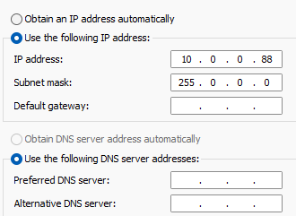

# An alternative way to access the device without UART / BOLT

A 'Service Mode' has been identified on this device, accessible by a specific remote control button combination.

The service console appears to have been designed for factory certification, however it presents us with some interesting findings, including negating the need to access the device via UART / BOLT in order to configure a different startup sequence or review the contents of the device.


## Setup

### PC Ethernet Configuration

Configure your PC's ethernet port as follows:


- Connect the Ethernet port of the Box directly to the Ethernet port of the PC you have configured above.
  
### Enter service mode
Boot up the box, it will likely try, and fail, to connect to the internet, presenting you with a familiar "welcome" screen.

Enter the below button sequence, you have 14 seconds to press these buttons:

If your remote does not have number buttons, but rather a '123' button, then you need to completley cover the remote when pressing the '123' button, otherwise that will get transmitted to the box and mess up the sequence.

**Up, Down, Left, Right, 6, 9, 1, 5, Red**

If you do this correctly, the box reboots within a second or two.

The box has configured itself into 'RUNLEVEL=4' (instead of the normal RUNLEVEL=1'

This will enter a service mode with an open Telnet service on port 23.

## Discovery

### Find the box's IP
The box will assign itself a completley random IP starting with 10.x.x.x and be attempting to contact some unknown server on IP '10.0.0.88'.

We can use 'WireShark' to watch incoming ARP packets from the network, and determine what IP is trying to contact us.


Open WireShark, monitor the Ethernet adapter, and add the below as the filter criteria to filter out extra noise:

```text
arp.dst.proto_ipv4 == 10.0.0.88
```

After a minute or two, you will see the box hunting for the server:
For example:

```text
Who has 10.0.0.88? Tell 10.123.23.543
```
The "Tell 10.x.x.x" is the IP of the box.

### Connect by Telnet

Using Putty or a plain powershell prompt, use Telnet to connect to that IP:

```text
telnet 10.247.58.119
```

A login prompt is displayed:
```text
(none) login:
```

Log in as **root**

there is no password


## The Service Console
### Overview
A root Linux maintenance shell running the box’s factory image, with:
- BusyBox commands for files, processes and networking.
- Access to USB storage and internal disks.
- A native utility to read/write boot settings, including RUNLEVEL and STARTUP.
- Factory hardware tests for HDMI, tuners, disk, Wi-Fi and remote input.
It runs an older Linux 3.14.28 kernel. Some factory reset, provisioning and upgrade functions can alter or erase device data.

### Some observed commands
A utility exists called "/home/hybroad/bin/yuxing-utility.elf"
this can change the "RUNLEVEL" and "STARTUP" variables

RUNLEVEL will modify the way the box boots (1=normal 4=service etc)

STARTUP provides a custom boot sequence without rebuilding the bootloader. It can be used to:
- Boot development firmware from USB or a network server.
- Run recovery or manufacturing scripts.
- Select an alternative kernel or OS.
- Selecting an external boot source before continuing with normal internal boot.

One could conceive of using this STARTUP variable to override the stock boot script and read a boot command from a USB for example:

```text
export LD_LIBRARY_PATH=/lib:/usr/lib:/home/hybroad/lib
/home/hybroad/bin/yuxing-utility.elf -env STARTUP \
'some new startup command' &&
/home/hybroad/bin/yuxing-utility.elf -env RUNLEVEL 1 &&
sync && reboot
```


## Returning to normal boot Operation

To exit the Service Console and get back to normal operation

Restore RUNLEVEL=1 and reboot:

```sh
LD_LIBRARY_PATH=/lib:/usr/lib:/home/hybroad/lib \
/home/hybroad/bin/yuxing-utility.elf -env RUNLEVEL 1 &&
sync && reboot
```

